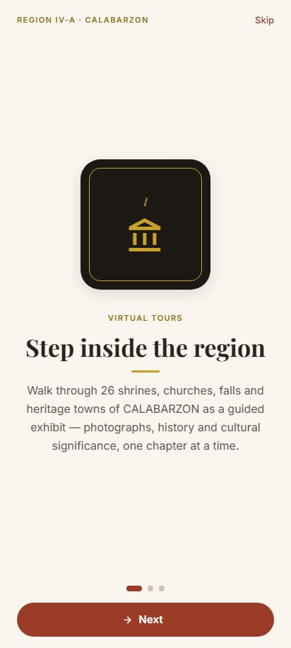
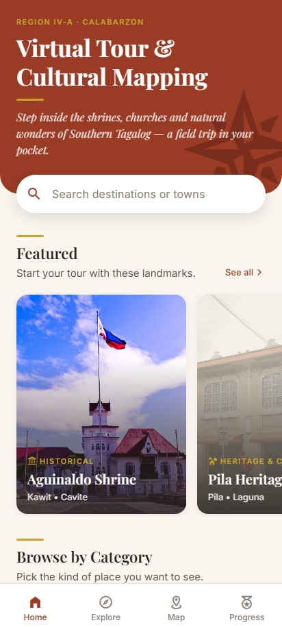
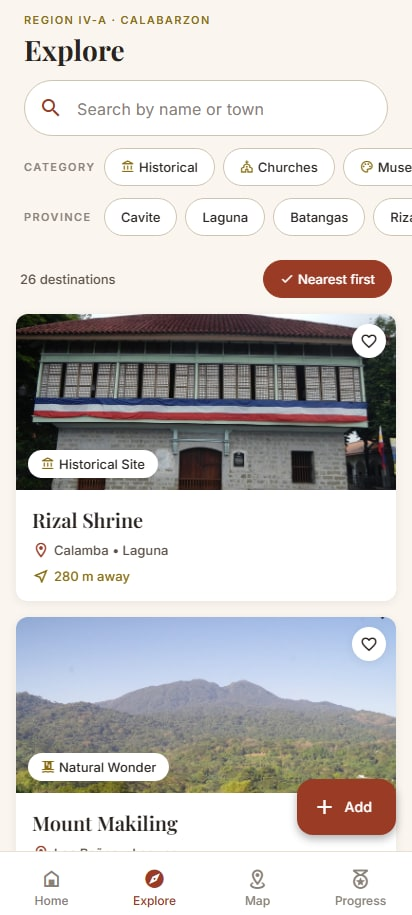
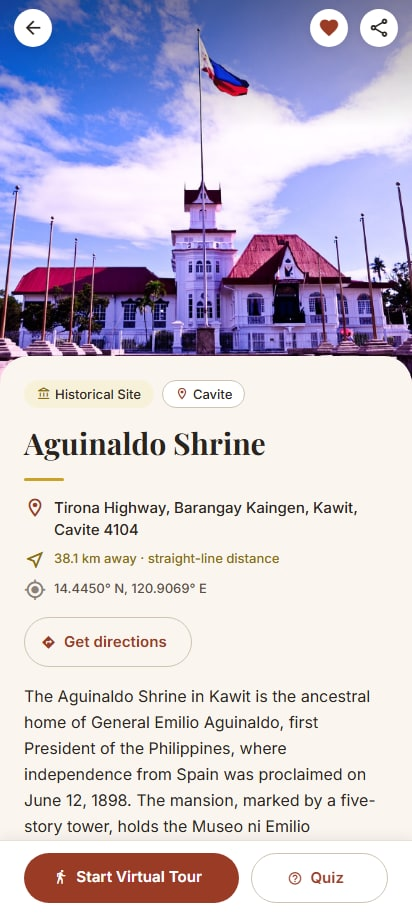
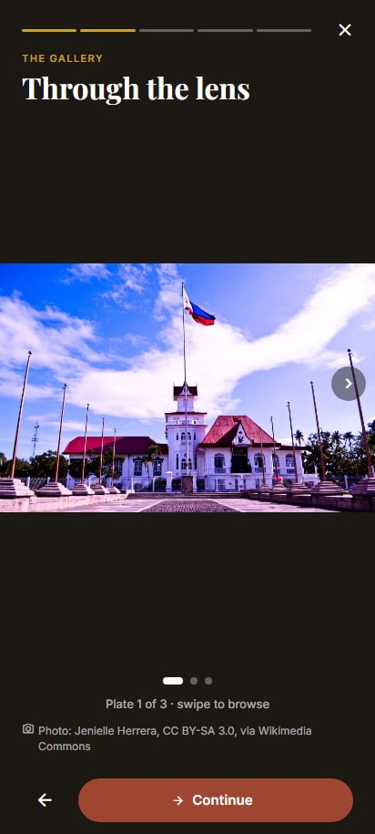
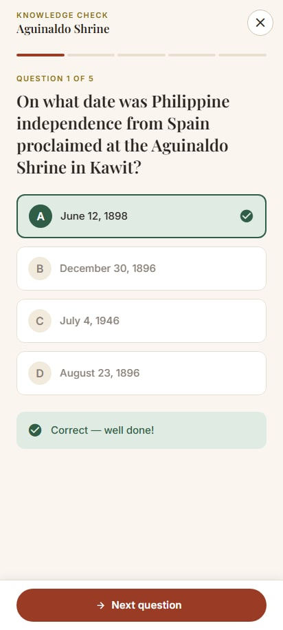
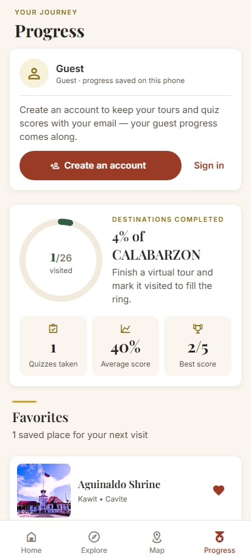

# Virtual Tour & Cultural Mapping — CALABARZON

**A museum-style mobile guide to 26 heritage sites and natural landmarks of
Region IV-A, Philippines — built as a field trip you can take from a phone.**

Expo SDK 58 · React Native 0.88 · TypeScript (strict) · Supabase · Android & iOS

<table>
  <tr>
    <td align="center"><br><sub>First launch</sub></td>
    <td align="center"><br><sub>Home</sub></td>
    <td align="center"><br><sub>Explore · Near me</sub></td>
    <td align="center"><br><sub>Details</sub></td>
  </tr>
  <tr>
    <td align="center"><br><sub>Virtual tour · gallery</sub></td>
    <td align="center"><br><sub>Virtual tour · chapter</sub></td>
    <td align="center"><br><sub>Quiz</sub></td>
    <td align="center"><br><sub>Progress & favorites</sub></td>
  </tr>
</table>

## Why it exists

School field trips to the shrines, churches and heritage towns of Cavite,
Laguna, Batangas, Rizal and Quezon are expensive and rare. This app offers the
next best thing: each destination is presented like a gallery exhibit — a
photo wall, a history chapter, a chapter on cultural significance — followed by
a short quiz written from that same text. When the virtual visit is done, it
hands over to Google Maps for the real one.

It was built for **WMA 306 — UI/UX and Cross-Platform Applications**, where the
interface itself is graded, so design consistency, accessibility and empty /
error states were treated as first-class requirements rather than polish.

## Features

**Learn**
- **Guided virtual tour** — full-screen sequence: introduction → swipeable
  photo gallery (every photo credited) → History → Cultural Significance →
  completion. Steps without content are skipped; Android back steps back.
- **Quiz engine** — five questions per destination, options reshuffled on
  every attempt, instant right/wrong feedback, score ring, unlimited retakes,
  best score kept. Every question is answerable from the destination's own
  text (checked by `npm run data:check`).

**Explore**
- **Search and filters** — search-as-you-type on name and town, combinable
  category and province filters, pull to refresh.
- **Near me** — with permission, each card shows "12.4 km away" and Explore can
  sort nearest first. Distances are computed on the device (haversine); no
  location ever leaves the phone. Permission is requested through an in-app
  explanation first, and declining simply hides the feature.
- **Map** — all 26 destinations on Google Maps, pins coloured by category, a
  legend that doubles as a filter, callouts that open the destination.
- **Get directions** — from a destination or the end of its tour, opens Google
  Maps with turn-by-turn directions from the current location (universal
  link, no API key; falls back to the browser when the app is not installed).
- **Share** — the native share sheet with the name, a one-line description and
  "Town • Province".

**Track**
- **Progress** — visited count out of 26, quiz statistics, a completion bar
  per province, and a "Your journey" timeline.
- **Favorites** — a heart on every card and destination page, collected on
  the Progress tab.
- **Accounts are optional** — guests get every feature; signing up with email
  and password moves the guest's visits, scores and favorites to the account.

**Feel**
- **Works offline** — the last-fetched catalogue and destination pages are
  kept on the device; without a connection the app shows them with a quiet
  "Offline — showing saved data" banner instead of an error.
- **Haptics** on answering a question, finishing a quiz and marking a place
  visited.
- **Onboarding** — a three-slide introduction on first launch, skippable and
  shown once.
- **Content management** — add, edit and delete destinations from the app,
  including photo picking, resizing and upload to cloud storage.

## Tech stack

| Area | Choice |
| --- | --- |
| App | [Expo](https://expo.dev) SDK 58, React Native 0.88, React 19 with the React Compiler, TypeScript in strict mode |
| Navigation | Expo Router (file-based) — a root stack with protected route groups around four bottom tabs; typed routes |
| UI | React Native Paper (Material Design 3) re-themed with custom tokens; Playfair Display + Inter; Reanimated for step transitions; react-native-svg for the progress ring |
| Maps & device | react-native-maps (Google Maps on Android), expo-location, expo-haptics, expo-image (with disk cache), expo-image-picker / manipulator |
| Backend | [Supabase](https://supabase.com): Postgres with Row Level Security, Storage for photos, Auth (email + password) |
| Local storage | AsyncStorage for the session, the guest key, one-time flags and the offline catalogue |
| Tooling | ESLint (expo config), Node's built-in test runner via tsx, Playwright for the web click-through, EAS Build for the APK |

Everything runs in **Expo Go** — no native module outside the Expo Go set is
used, so the app can be opened on any phone by scanning a QR code.

## Architecture

```
 screens (src/app)          components (src/components)
        │ read via hooks          │ shared UI, design tokens only
        ▼                         ▼
 hooks (useAsyncData) ──► repositories (src/repositories) ──► supabase-js ──► Postgres / Storage / Auth
        │                         ▲
        │ offline fallback        │ same factories, run in Node by the live test scripts
        ▼                         │
 offline cache (AsyncStorage)   pure logic (src/lib): quiz scoring, progress stats,
                                distances, favorites merge, share text, form rules
```

- **Repository pattern.** Screens never import supabase-js. Each repository
  is a factory that receives a client (`createDestinationsRepository(client)`),
  so the exact code the app runs is also exercised against the live database
  by `npm run db:test` under Node.
- **Read hooks, not a global store.** `useAsyncData` gives every read a
  `loading / error / success` state, retry and pull-to-refresh, ignores stale
  responses, and refetches when any screen reports a write through a tiny
  `DataSyncContext` counter. No Redux; four small contexts in total, plus
  location and favorites.
- **Identity model.** Progress rows carry one "user key": the Supabase auth
  user id when signed in, otherwise a random device UUID kept in AsyncStorage.
  Guests and accounts therefore share one code path, and signing up is a
  single re-keying of the guest's rows (with duplicates resolved first).
- **Offline by degradation, not sync.** Every successful catalogue read is
  saved; an offline failure is answered from the saved copy, and filtered
  Explore searches are re-run locally on the saved catalogue. Writes still
  need a connection and say so.
- **Design system.** All colours, type ramps, spacing (4/8 pt), radii, shadows
  and sizes live in `src/theme`; screens contain no literal colours or font
  sizes. The palette — terracotta, heritage gold, warm cream — and the serif
  headings follow the look of a national museum's exhibit labels. Every screen
  has skeleton loading, a friendly empty state and an error state with retry;
  touch targets are at least 48 dp and font scaling is capped at 1.3×.
- **Content as data.** The 26 destinations, their texts, photo credits and
  quizzes live in one reviewable file, `data/destinations-seed.json`, with the
  sources each entry was checked against. Nothing in the app refers to a
  specific destination.

## Database

`supabase/schema.sql` defines the structure; `data/destinations-seed.json` is
the content. Additive changes ship as idempotent files in
`supabase/migrations/` (applied with `npm run db:migrate`, never a reset).

| Table | Holds |
| --- | --- |
| `destinations` | The catalogue: name, description, address, town, province and category (both CHECK-constrained), coordinates, history, cultural significance, cover photo |
| `destination_images` | Ordered photos per destination with their credit lines (row 0 is the cover) |
| `quiz_questions` / `quiz_options` | Five questions per destination, four options each, exactly one correct |
| `quiz_attempts` | One row per finished quiz, by user key |
| `destination_completions` | "Visited" marks, unique per destination and user key |
| `favorites` | Hearted destinations, unique per destination and user key |

All child tables cascade on delete. Row Level Security is enabled on every
table. For this school project the policies are intentionally permissive for
both `anon` (guests) and `authenticated` users; `schema.sql` documents how a
production deployment would scope progress rows to `auth.uid()` and restrict
catalogue edits to editors.

## Getting started

**Try it:** the Android APK is attached to the
[latest release](https://github.com/clarkdesepida0154/virtual-tour-calabarzon/releases/latest).

**Run it from source** (Node.js 20+, the Expo Go app on a phone):

```bash
git clone https://github.com/clarkdesepida0154/virtual-tour-calabarzon.git
cd virtual-tour-calabarzon
npm install
cp .env.example .env        # then fill in the values below
npx expo start              # scan the QR code with Expo Go
```

`.env` (git-ignored — `.env.example` lists the same names):

| Variable | Used by | Notes |
| --- | --- | --- |
| `EXPO_PUBLIC_SUPABASE_URL` | app | Your Supabase project URL |
| `EXPO_PUBLIC_SUPABASE_PUBLISHABLE_KEY` | app | The publishable key (safe to ship; access is governed by RLS) |
| `SUPABASE_DB_URL` | setup and test scripts only | Postgres connection string (session pooler); never read by app code |
| `GOOGLE_MAPS_ANDROID_API_KEY` | standalone Android builds only | Expo Go brings its own Maps key |

To create your own backend, make a Supabase project, fill in `.env`, then run
`npm run db:setup` — it creates the schema, uploads the 78 photos and loads
the full dataset. For email sign-up without a confirmation email, turn off
*Authentication → Sign In / Providers → Email → Confirm email*.

If the phone cannot reach the dev server, put both devices on the same
network, allow Node.js through the firewall, or use `npx expo start --tunnel`.

**Build the APK:** `npx eas-cli build --platform android --profile preview`
(see `eas.json`; the Supabase values and the Maps key are supplied as EAS
environment variables).

## Testing

| Suite | Command | What it covers | Checks |
| --- | --- | --- | --- |
| Unit | `npm test` | Quiz scoring and shuffling, best scores, progress statistics, auth validation, distances and sorting, favorites merge and transfer rules, offline cache, directions link, share text | 44 |
| Data layer (live) | `npm run db:test` | The app's repositories against the real project: search and filters, CRUD, storage upload, quiz rows, attempts, visits, favorites (idempotency, isolation, cascade), guest → account transfer. Cleans up after itself | 38 |
| Auth (live) | `npm run auth:test` | Sign-in and sign-out, signed-in RLS, progress under the auth user id, friendly errors, with a temporary user | 6 |
| End to end | `node scripts/web-clickthrough.mjs <web export>` | Headless Playwright walk through every flow of the web build: onboarding, Welcome, guest, Near me, favorites, share, directions, tour, quiz, map, progress, offline banner, sign in / out, session restore | 94 |
| Dataset | `npm run data:check` | Schema of the content file, and that every quiz answer appears in its destination's text | — |
| Database | `npm run db:verify` | Tables, RLS policies, the 26 destinations, 78 photos and 130 questions, live photo links | — |
| Static | `npm run typecheck` · `npm run lint` · `npx expo-doctor` | Strict TypeScript, ESLint, 20 Expo project checks | — |
| Secrets | `npm run secrets:check` | No password, secret key or credentialed connection string in any file or any commit | — |

## Content and image licensing

Texts were written for this project in a neutral, museum-label register and
checked against Wikipedia and official or heritage sources; contested claims
are attributed rather than stated, and each entry records its sources and
caveats in the dataset.

All 78 photographs come from [Wikimedia Commons](https://commons.wikimedia.org)
under public-domain, CC0, CC BY or CC BY-SA terms. Each photo's author and
licence are shown in the app wherever the photo appears large, and listed in
full in [`data/IMAGE_CREDITS.md`](data/IMAGE_CREDITS.md). The photos keep
their original licences; they are not covered by the code licence.

## Project structure

```
src/
  app/                 Routes (Expo Router): onboarding, welcome, sign-in, sign-up, add
    (tabs)/            Home, Explore, Map, Progress
    destination/[id]/  Details, Edit, Virtual Tour, Quiz
  components/          Shared UI — cards, chips, badges, states, form, map
  context/             Data sync, filters, toasts, identity, location, favorites
  hooks/               Data-loading hooks (useAsyncData and friends)
  lib/                 Pure logic + device helpers (quiz, progress, geo, favorites, offline cache)
  repositories/        The only code that talks to Supabase
  theme/               Design tokens and the Paper / navigation / map themes
supabase/              schema.sql and additive migrations
data/                  The dataset, processed photos, photo credits
scripts/               Setup, seeding, migrations, live tests, photo curation, secret scan
tests/                 Unit tests
```

## Roadmap

- **Dark mode** — the tokens are already centralised; a second palette and a
  system-theme switch are the remaining work.
- **English / Filipino** — move UI strings and dataset texts to a translation
  layer and add Filipino versions of the 26 entries.
- **Google Play release** — signed AAB, store listing, and the production RLS
  policies described in `schema.sql`.
- Audio narration for each tour chapter, and more destinations per province.

## Known limitations

- Database security is deliberately open for a classroom project (anyone can
  edit the catalogue; progress rows are not owner-locked in the database).
- A guest's progress is tied to that installation until they create an account.
- Offline mode shows destinations already loaded once; quizzes and progress
  updates need a connection.
- The web build is used for automated testing only; its map is a schematic
  stand-in because native Google Maps runs only on the phone.
